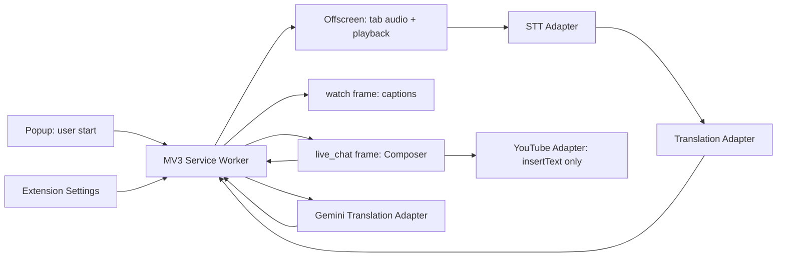

# KeroTranslation 設計と実装計画

2026-10-06 JST / 初版。添付の依頼文・仕様書を参考資料として扱い、今回の「これ組む」に対して設計＋ローカルPoCソースを作成した。資料内の過去合意と今回の採用案は区別する。

## 1. 範囲と今回の判断

引継ぎ仕様は、YouTube Live、EN↔JA、BYOK、音声字幕、自分のコメント翻訳、手動投稿、STT/翻訳分離。OBS、Hosted、全コメント翻訳、共有辞書、課金、学習基盤は実装していない。

今回の可逆的な採用案：

| 判断 | 初版で採用した案 | 理由・見直し条件 |
|---|---|---|
| UI名 | KeroTranslate | 仕様書の仮称を継承。正式名は未決 |
| 言語・UI | JavaScript ES Modules / Shadow DOM / CSS | 外部依存・ビルド工程なしでMV3を読み込める。型とSDKが増えた段階でTypeScript化 |
| 初期翻訳 | Gemini / モデルID編集可能 | RESTの小さなAdapterで構成。品質優位を断定しない |
| 初期STT | Deepgram Nova-3 | 公式がstreamingと日英を含むmultiを記載。実配信の品質は別評価 |
| MTL | 直接編集可 | 編集版からre-MTLのみ再生成 |
| MTL INSERT | READYまで待つ | 最新のre-MTLまで確認可能にする。速度比較後に変更可能 |
| 既存下書き | 空なら挿入、既存なら置換/維持 | 確認中に純正側が変わった場合も再確認。追記は初版に入れない |
| 言語 | ComposerはJA→EN/EN→JA。字幕は固定出力言語 | 日英混在STTは実験的。言語ごとに出力先を自動反転しない |
| キー | セッション保存のみ | 永続保存のリスクと追加UIを初版で避ける |
| 字幕 | 初期BC、原文＋訳文、各最大2行、7秒保持 | 最新発話だけ。1/2行は各言語の最大行数であり、両方表示は最大2/4行 |
| 対象画面 | 通常視聴を基準 | 全画面・シアター・ポップアウトは検証後に対応表を更新 |
| ローカル辞書 | 後続 | 初期精度測定で必要な固有名詞を特定してから |

debounce 650ms、HTTP timeout 20秒、STT接続timeout 12秒、無認識表示15秒、音声チャンク250msは今回の仮値であり、過去合意・性能保証ではない。停止・失敗後の再開始は手動。

## 2. UI

通常視聴では動画プレーヤー内に字幕を重ねる。表示はOriginal only / MTL only / Original + MTL、設定画面の9マスでアンカー選択。Original onlyでは字幕用の翻訳APIを呼ばない。

チャットのnative message input直前に独立したComposerを追加する。純正チャットや入力欄そのものを置き換えない。Composer上限55vh、狭い領域はスクロール。資料の約2/3＋1/3を固定比率では強制しない。現行YouTubeでレイアウトが成立するかは未検証。

Originalは編集可能、MTLは最新訳がある間に編集可能、re-MTLは読み取り専用。状態とProviderをヘッダーに表示。再翻訳失敗時も原文を保持し、再翻訳工程だけ再試行。入力確認と実際のINSERT失敗を分けて表示する。挿入先判定はクリック時に行い、ログアウト・チャット無効・DOM不明時は理由を表示して中止する。

開始停止は拡張ツールバーのポップアップ。キーは拡張専用設定ページだけで扱う。Composerの⚙から設定を開ける。IncomingとComposerの翻訳は独立しており、字幕のStopはComposerの編集機能を止めない。

## 3. 実行環境と権限

- Content scriptはisolated world。YouTube DOMを触る箇所はyoutube.jsへ集約。MAIN worldへのスクリプト挿入、window.postMessage、外部メッセージ受信設定は使わない。
- watchのトップフレームに字幕、live_chatのフレーム内にComposerを配置する。親フレームからiframe内部を書き換える構成にしない。
- Workerはキー、設定、capture session、タブ/フレーム別のComposerリクエストを管理。1フレーム1件、1拡張1音声セッション。
- Offscreenは音声・WebSocket・MediaRecorderを所有する。Chrome拡張APIはruntimeだけを利用し、storage等はWorker経由にする。[offscreen公式](https://developer.chrome.com/docs/extensions/reference/api/offscreen)
- ユーザーが開始したタブのstream IDをWorkerが取得し、offscreenで消費。AudioContextのdestinationへ接続して視聴音を継続する。Chrome 116以降の公式パターンに基づく。[音声取得](https://developer.chrome.com/docs/extensions/how-to/web-platform/screen-capture)
- 権限はstorage / activeTab / tabCapture / offscreen。YouTubeのhost権限はホームからwatchへのSPA遷移とlive_chat frameへの常駐接続に使う。API hostはGoogleとDeepgramだけ。マイク・全サイト権限・remote script・第三者分析SDKはない。
- API fetchは拡張側で行う。通常ページのCORS制約と拡張host permissionの挙動は同一ではない。[Chromeのcross-origin要求](https://developer.chrome.com/docs/extensions/develop/concepts/network-requests)

キーはlocal/syncへ保存しない。storage.local（非秘密設定）とstorage.session（キー等）はTRUSTED_CONTEXTSに制限する。content scriptへはsanitized設定だけを返す。APIレスポンス本文や生の認証例外は通常UIへ出さない。closed Shadow DOMはスタイル分離の補助であり、キーを守る境界として頼らない。

## 4. 版管理・キャンセル・停止

ComposerはrevisionとAbortControllerを持つ。原文・方向・設定変更でrevisionを進めて既存処理を中断する。非同期応答はrevisionが一致するときだけ反映する。MTL編集では同様に更新し、編集後のMTLを再翻訳元にする。旧訳からREADYを復元できない。

`EMPTY → STALE → TRANSLATING → BACK_TRANSLATING → READY`。MTL編集は`EDITING_MTL → BACK_TRANSLATING`。失敗は`ERROR`で原文保持。IME composition中は送信しない。Original INSERTは非空なら可能、MTLはREADYのみ。2工程の対応が取れない結果は挿入させない。

字幕はcapture session ID＋Deepgram segment start IDで対応付ける。interimは原文だけ、finalで翻訳。新しい発話が出たら前の訳を併記しない。前の翻訳が遅れた場合は表示しない。**初版は全発話の逐次表示を保証しない**。高密度な会話では字幕を飛ばす可能性があり、キュー/確定発話の束ね方を実測で検討する。

停止はcapture IDを無効化してからoffscreenへ通知し、Recorder、WebSocket、MediaStream全track、AudioContext、タイマー、字幕翻訳を停止する。開始途中のgetUserMediaが停止後に返った場合もtrackを止める。Workerのcaptureイベントと開始停止を直列化し、遅れたイベントでsessionが復活しないようにする。

トップページ遷移・タブ終了は録音停止。frame再読み込み・遷移はそのComposerを破棄し未完了要求を中断。SPA再接続は限定したMutationObserverとURLチェック。再接続に失敗した場合は自動再録音しない。

HTTP 401/403、404、429、5xx、timeout、network、空/不完全応答を区別。429はquotaとrate-limitを断定しない。WebSocketのブラウザーエラーはHTTP認証詳細を取得できないため、認証・quota・networkを断定せずProvider管理画面への確認を促す。NO_SPEECHは無認識であり、完全な無音測定ではない。

## 5. Providerの実現性と比較順

確認日2026-10-06。以下はAPI公式仕様確認と設計判断。実接続に成功したという意味ではない。

| 順 | 候補 | 今回の扱い・確認内容 |
|---|---|---|
| 1 | Gemini / 翻訳 | REST generateContent実装。system instructionとuser textを分離。モデルIDは設定可能、初期gemini-3.5-flash-lite。実キー検証待ち。[API](https://ai.google.dev/api/generate-content)・[モデル一覧](https://ai.google.dev/gemini-api/docs/models) |
| 1 | Deepgram / STT | Nova-3 multiは公式上日英を含む。ブラウザーWSのtoken subprotocol認証を実装。実キー・混在配信検証待ち。[言語](https://developers.deepgram.com/docs/models-languages-overview)・[接続](https://developers.deepgram.com/docs/using-the-sec-websocket-protocol) |
| 2 | Azure Speech / STT | 公式はJS SDKのcontinuous language identificationを記載。候補言語制約、音声フォーマットとSDKの同梱サイズを次に比較。未実装。[公式](https://learn.microsoft.com/en-us/azure/ai-services/speech-service/language-identification) |
| 3 | Groq Whisper / STT | 音声ファイルAPIを確認。録音チャンクの独立デコード、重複・分割点、最低請求単位を検証して比較。現streaming構成と同条件ではない。未実装。[公式](https://console.groq.com/docs/speech-to-text) |
| 3 | DeepL / 翻訳 | 公式は通常ブラウザーからの直呼びを非対応としている。拡張Worker＋host permissionでの実接続と利用条件を別途検証してから採否判断。Hosted proxyを初版へ追加しない。未実装。[公式](https://developers.deepl.com/docs/best-practices/cors-requests) |
| 4 | OpenAI / STT・翻訳 | 候補として維持。今回の接続方式・料金調査と実装は未着手。着手時にRealtime/音声API/翻訳APIの公式仕様を確認し、同じ素材で比較 |
| 5 | Local Whisper / faster-whisper | ローカル補助プロセスを別構成として評価予定。ブラウザー内完結と仮定しない。通信認証・配布・GPU/CPU条件の検証は未着手 |

実装の分離境界は `createSttProvider(...).start(media)/stop()` と `translate({text,source,target,signal},settings,keys)`。現在それぞれDemo＋1実Providerであり、実Provider同士の切替検証は未完了。STTと翻訳は独立に選べる。re-MTLは初版ではMTLと同じProvider、同じモデルを使う。

### 費用と無料枠

- Gemini 3.5 Flash-Lite Standardは確認時の公式表で入力$0.30/100万tokens、出力（thinking含む）$2.50/100万tokens。Free Tier欄は無料だが、利用可能枠・地域・アカウント上限の保証ではない。無料/有料でデータ改善利用の扱いも異なる。[料金表](https://ai.google.dev/gemini-api/docs/pricing)
- DeepgramのNova-3 Multilingual streaming Pay As You Goは確認時の表示価格$0.0058/分、通常価格欄$0.0092/分。プロモーション、アカウント条件、opt-out等で実請求が異なる可能性があるので、製品内の保証額には使わない。[料金表](https://deepgram.com/pricing)
- 本実装はDeepgramへ `mip_opt_out=true` を送る。学習除外フラグの有効性はProvider usage logsで確認する。[データの扱い](https://developers.deepgram.com/trust-security/your-data)
- 60分×表示単価$0.0058=$0.348はSTTだけの参考計算。翻訳/再翻訳・条件差を含む総額ではない。実請求は各Provider管理画面と照合する。
- Kero Free/Paidの価格、時間制限、決済、配布時の料金設計は未決のまま。API価格から勝手に製品価格を決めない。

## 6. 未決事項と残す接続点

正式名、re-MTL前のINSERT許可、MTL/re-MTLの別Provider選択、全画面等の正式対応範囲、永続キー保存、配布範囲と料金は今後決定する。初版を触ってから変更できるものは表1の仮案で進めた。

ローカル辞書の初案は `{version:1, entries:[{source:"...",target:"...",from:"ja",to:"en",mode:"preserve|translate"}]}`。regex・公開共有・自動選択は後続。Providerによってprompt/context/glossary適用方法が異なるため、共通の文字列置換で品質保証しない。現在コードには未実装。

未来の出力先は字幕のcueイベントに接続できる。OBS/Hostedのサーバーや権限を事前に持ち込まない。

YouTube利用条件は確認したが、音声の外部処理やDOM挿入の適合性を「INSERTのみだから問題ない」と結論していない。公開前に対象用途・データ処理・Store申告とともに別途検討する。[YouTube利用条件](https://www.youtube.com/static?template=terms)

## 7. 実装段階・合格条件

| 段階 | 今回の到達点 | 次の合格条件 |
|---|---|---|
| P0 設計 | 本書、構成・状態・仮決定を作成 | UIを見て大きな導線を評価 |
| P1 状態/UI | 実装。42テストと構文検査通過 | ブラウザー目視・キーボード・小画面確認 |
| P2 YouTube接続 | Adapter、frame接続、INSERT実装 | A02/A03/A12/A13の実機確認。送信ゼロ、Emote保持 |
| P3 BYOK | Gemini/Deepgram Adapter、キー境界実装 | 実キー認証、STT中の音声、遷移停止、Provider請求照合 |
| P4 実配信評価 | 手順のみ | 日英混在・歌/BGM・笑い・短文・固有名詞で遅延/品質/費用測定 |
| P5 α配布 | 未着手 | 複数Provider比較、privacy説明、障害復旧、実機対応表 |

初版コードはP1〜P3の土台を並行して作ったが、統合確認が済むまではP3完了・PoC合格としない。確認方法とA01〜A15はACCEPTANCE.mdにまとめる。

