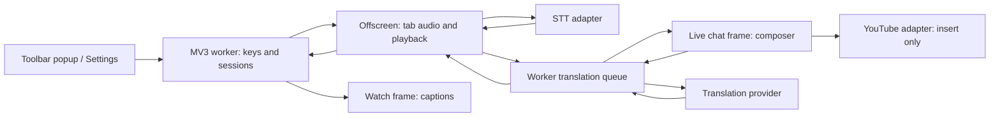

# KeroTranslate design and implementation plan

[日本語の原文](DESIGN.jp.md) · [Current README](../README.md)

Original design: October 6, 2026 JST; name/caption/test updates on October 7. English edition with current architecture notes: October 8. The supplied design request and specification were reference material. Earlier agreements, proposals and implementation decisions are distinguished below.

**Current beta changes:** OpenAI, DeepL and DeepSeek adapters were added in 0.1.6; all translation HTTP now goes through the worker queue added in 0.1.8. Beta 0.1.10 removes Demo providers and preview distribution. Use the [provider notes](PROVIDERS-0.1.6.md) and README for current behavior; historical comparisons below are not claims that an adapter is still missing.

## 1. Scope and adopted decisions

The handoff scope is YouTube Live, EN↔JA, BYOK, audio captions, translating the user's own comments, manual posting and separate STT/translation providers. OBS, hosted services, translating everyone's comments, shared dictionaries, billing and training infrastructure are not implemented.

| Decision | Adopted approach | Reason / reconsideration |
|---|---|---|
| Product name | KeroTranslate | Standardized October 7, 2026 |
| Language/UI | JavaScript ES modules, Shadow DOM, CSS | Load MV3 without external runtime dependencies or a build step; reconsider TypeScript as types/SDKs grow |
| Initial translation adapter | Gemini, configurable model ID | Small REST adapter; no claim of superior quality |
| Initial speech adapter | Deepgram Nova-3 | Streaming/multilingual design; real-stream quality needs separate evaluation |
| MTL editing | Allowed | Regenerate only re-MTL from edited translation |
| MTL INSERT | Wait until READY | Let the user check current back-translation; revisit after measuring speed |
| Existing draft | Insert if empty; otherwise replace/keep | Reconfirm if native input changes during confirmation; no append mode initially |
| Languages | EN→JA or JA→EN composer; fixed caption output | Mixed STT is experimental; no automatic reversal of caption target per segment |
| Keys | Local persistence since 0.1.11 | Retain user-entered credentials across restarts; restrict access to trusted extension contexts |
| Captions | Bottom-center, original + translation, maximum two lines each, ten seconds after translation | Configurable 75–200% size; newer provisional text has a separate row |
| Target layout | Normal watch page | Update fullscreen/theater/pop-out support after testing |
| Local dictionary | Deferred | Identify needed names through initial accuracy evaluation |

Implementation defaults, not prior agreements or performance guarantees: 650 ms debounce, 20-second translation HTTP timeout, 12-second Deepgram connection timeout, 20 seconds for the added STT adapters, NO_SPEECH after 15 seconds without recognition, 250 ms Deepgram audio chunks. Restart after Stop/failure is manual.

## 2. UI

Captions overlay the video player. Original only / MTL only / Original + MTL and a nine-anchor position selector are available. Original only makes no caption translation API calls.

Add an independent composer before the native live-chat input; do not replace the chat or input. The panel is capped at 55vh and scrolls in constrained space. The approximate two-thirds chat/one-third composer proposal is not a fixed ratio requirement. Current YouTube layout still needs visual validation.

Original is editable, current MTL can be edited, and re-MTL is read-only. Show state/provider compactly. Preserve Original after re-MTL failure and retry that stage alone. Distinguish draft checks from actual insertion failures. Determine the target when INSERT is clicked; explain and stop when signed out, chat is disabled or the DOM is unrecognized.

Capture starts/stops in the toolbar popup and main panel. The toolbar popup is the recommended first-start route on a new tab. Only the extension's settings page handles keys; the panel gear opens it. Stopping captions does not stop composer editing.

## 3. Execution contexts and permissions

- Content scripts run in the isolated world. YouTube DOM handling lives in `youtube.js`. No MAIN-world injection, `window.postMessage` bridge or externally connectable messaging is used.
- Put captions in the top watch frame and the composer inside the live-chat frame, not by editing an iframe from its parent.
- The worker manages keys, settings, capture sessions and per-tab/frame composer requests. One pending composer request per frame; one audio session per extension.
- Offscreen owns audio, WebSocket and MediaRecorder resources. Of Chrome extension APIs, it uses runtime messaging; storage is accessed through the worker. [Offscreen API](https://developer.chrome.com/docs/extensions/reference/api/offscreen).
- The worker obtains the stream ID for the user-invoked tab; offscreen consumes it and connects audio to AudioContext's destination so playback continues. The design follows Chrome 116+ capture patterns. [Audio capture](https://developer.chrome.com/docs/extensions/how-to/web-platform/screen-capture).
- Permissions are storage, activeTab, tabCapture and offscreen. YouTube host access supports SPA navigation and the chat frame. Provider hosts are explicitly listed for Gemini, Deepgram, OpenAI, DeepL and DeepSeek. No microphone/all-sites permission, remote script or analytics SDK is requested.
- API calls run in extension contexts. Ordinary-page CORS behavior is not identical to extension host permissions. [Cross-origin requests](https://developer.chrome.com/docs/extensions/develop/concepts/network-requests).

Since Beta 0.1.11, keys and settings use storage.local, restricted to TRUSTED_CONTEXTS. Capture state and metrics use storage.session with the same access restriction. Keys are never stored in storage.sync. Remaining legacy session keys migrate only when no local key record exists; an existing local record wins. The legacy copy is removed after a successful migration. Delete all API keys removes both local and legacy session copies. Local storage is not an encrypted credential vault. Content scripts receive sanitized settings only. Raw API bodies and authentication exceptions are not normal UI output. Closed Shadow DOM provides style isolation, not the secret boundary.

## 4. Revisions, cancellation and Stop

Composer uses a revision counter and AbortController. Original, direction or settings changes invalidate work; async output applies only to its matching revision. Editing MTL creates a new revision and back-translates the edit. An old translation cannot restore READY.

`EMPTY → STALE → TRANSLATING → BACK_TRANSLATING → READY`; manual edits use `EDITING_MTL → BACK_TRANSLATING`. Errors preserve Original in ERROR. No requests during IME composition. Original INSERT requires text; MTL INSERT requires READY and matching translation/back-translation.

Caption events use a capture session ID and provider segment IDs/sequences. Partials show dim source text with an ellipsis, finals show normal text and trigger translation. Preserve the previous translation beside newer recognition. Finish the active translation and retain only the newest waiting segment. This does not guarantee every utterance; dense conversation can skip segments. Evaluate batching/queue strategy with real streams.

Stop invalidates the session before notifying offscreen, then stops recorder, sockets, tracks, AudioContext, timers and pending caption requests. Tracks returned by late getUserMedia calls are also stopped. Serialize worker capture events/start/stop so late events cannot revive sessions.

Top-frame navigation and tab closure stop recording. Frame reload/navigation disposes its composer and cancels requests. Limited MutationObservers and URL checks handle SPA reconnection; failures do not silently restart recording.

Differentiate 401/403, 404, rate/quota errors, 5xx, timeout, network and empty/incomplete responses. Do not infer whether 429 specifically means quota or rate limiting. Browser WebSocket errors do not expose enough HTTP detail to distinguish bad credentials, quotas and network failure; direct users to provider usage. NO_SPEECH means no recognition, not measured silence.

## 5. Historical provider comparison

The following records the October 6 design review, not successful live connections or current support status.

| Order | Candidate | Original decision / evaluation |
|---|---|---|
| 1 | Gemini translation | Implement REST generateContent, separate system instruction/user text, configurable model initially `gemini-3.5-flash-lite`; real-key validation pending. [API](https://ai.google.dev/api/generate-content), [models](https://ai.google.dev/gemini-api/docs/models) |
| 1 | Deepgram STT | Nova-3 multi and token-subprotocol browser WebSocket authentication; mixed-stream/key validation pending. [Languages](https://developers.deepgram.com/docs/models-languages-overview), [connection](https://developers.deepgram.com/docs/using-the-sec-websocket-protocol) |
| 2 | Azure Speech STT | Compare continuous language identification, candidate-language restrictions, audio formats and SDK size; not implemented. [Reference](https://learn.microsoft.com/en-us/azure/ai-services/speech-service/language-identification) |
| 3 | Groq Whisper STT | File-based API; evaluate independently decodable chunks, overlaps/boundaries and minimum billing units; not equivalent to streaming, not implemented. [Reference](https://console.groq.com/docs/speech-to-text) |
| 3 | DeepL translation | At design time, extension-worker connectivity and terms required evaluation separately from ordinary browser CORS; no hosted proxy planned. Added later in 0.1.6. [CORS](https://developers.deepl.com/docs/best-practices/cors-requests) |
| 4 | OpenAI STT/translation | Initially a candidate awaiting API/billing study; adapters added in 0.1.6 |
| 5 | Local Whisper / faster-whisper | Evaluate as a separate local-helper architecture; do not assume browser-only execution. Authentication/distribution/GPU/CPU evaluation pending |

Adapter boundaries are `createSttProvider(...).start(media)/stop()` and `translate({text,source,target,signal},settings,keys)`. The initial code had one real adapter plus Demo for each role. The beta now has three STT/four translation adapters and no Demo. STT/translation are independent; MTL/re-MTL share provider/model.

### Historical cost notes

These are dated design notes, not current prices or product promises; check provider dashboards and official pricing before use.

- The recorded Gemini 3.5 Flash-Lite Standard table showed $0.30/million input tokens and $2.50/million output tokens including thinking. A free-tier column did not guarantee account/region allowance; data-use terms also differed. [Pricing](https://ai.google.dev/gemini-api/docs/pricing).
- Recorded Deepgram Nova-3 multilingual streaming PAYG pricing showed $0.0058/minute and a $0.0092/minute regular-price column. Promotions, account terms and opt-out could change actual billing. [Pricing](https://deepgram.com/pricing).
- The adapter sends `mip_opt_out=true`; verify handling in provider usage logs. [Data handling](https://developers.deepgram.com/trust-security/your-data).
- The illustrative calculation 60 × $0.0058 = $0.348 covered STT only, excluding translation/back-translation and account differences.
- Product Free/Paid pricing, time allowances and billing remain undecided; do not derive product prices automatically from API prices.

## 6. Open decisions and future extension points

Potential future decisions include allowing INSERT before re-MTL, separate MTL/re-MTL providers, supported display modes, persistent key storage and distribution/pricing. Current reversible choices can be revisited after hands-on evaluation.

A possible local dictionary format is `{version:1, entries:[{source:"...",target:"...",from:"ja",to:"en",mode:"preserve|translate"}]}`. Regex, public sharing and automatic selection are deferred. Providers differ in prompt/context/glossary support; common string replacement does not guarantee quality. No dictionary is implemented yet.

Future outputs can subscribe to caption cues; do not prebuild OBS/Hosted servers or permissions. The original review did not conclude that external audio processing or DOM insertion complies with YouTube's terms merely because INSERT does not send. Review intended use, data handling and store declarations for distribution. [YouTube terms](https://www.youtube.com/static?template=terms).

## 7. Original implementation stages

| Stage | Original progress | Next acceptance condition |
|---|---|---|
| P0 Design | Architecture, states, provisional decisions documented | Inspect UI and main workflows |
| P1 State/UI | Implemented; 58 tests and syntax checks at that checkpoint | Browser, keyboard and narrow-screen checks |
| P2 YouTube | Adapter, frame connection and INSERT implemented | Real A02/A03/A12/A13 checks, no sending, preserved emotes |
| P3 BYOK | Initial Gemini/Deepgram and key boundaries | Real authentication, audible STT, navigation stop and billing reconciliation |
| P4 Live evaluation | Procedure only | Mixed languages, music/laughter, short phrases/names; latency/quality/cost |
| P5 Alpha distribution | Not started at that checkpoint | Provider comparison, privacy information, recovery and support matrix |

The initial implementation built P1–P3 foundations together, but integration checks are required before calling P3 complete. See [acceptance criteria](ACCEPTANCE.md) for A01–A15.

## 0.1.8 shared translation queue

Offscreen no longer calls translation providers directly. It sends CAPTION_TRANSLATE with the session ID to the worker. The worker checks the sender/current capture ID and schedules comments/captions in the same provider-specific queue. Stop/key deletion cancel caption requests too. The 20-second HTTP timeout starts on dispatch, excluding queue wait. The default four-second start interval is adjustable and does not guarantee an account's quota.
